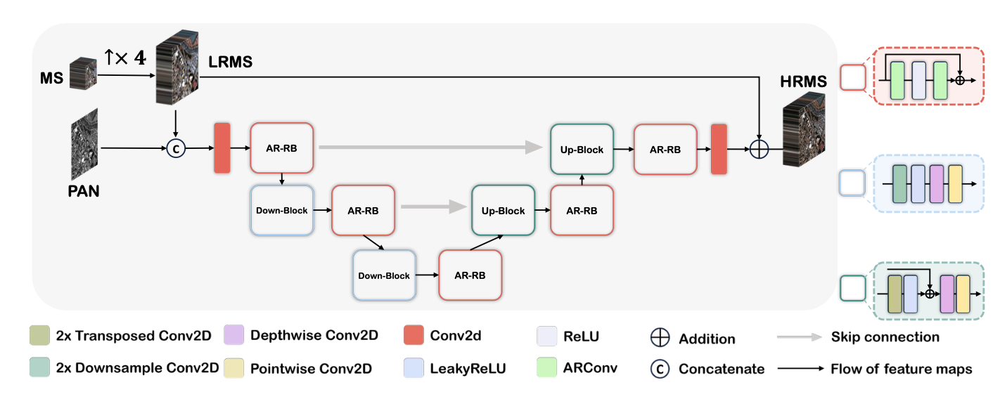
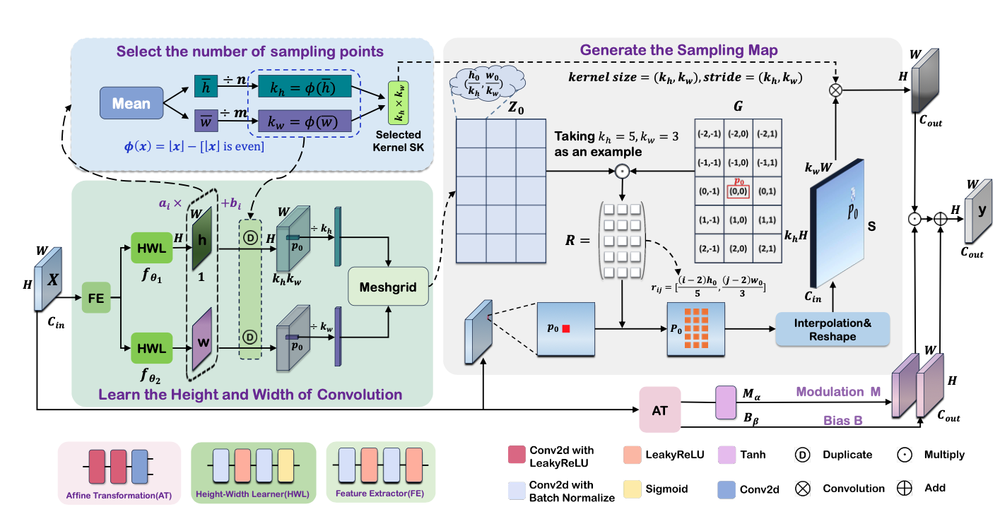

## 研究任务

遥感图像中的地物尺寸和形状差异显著，例如小型车辆、大型建筑和细长道路。传统卷积的采样窗口为固定大小的正方形，采样点数量也固定，难以适应不同地物的尺度与长宽比，导致特征提取不充分。已有可变形卷积虽然可以调整采样位置，但采样点数量仍固定，且逐点学习偏移会增加开销。

## 整体架构：ARNet

ARNet 首先将 MS 图像上采样至与 PAN 相同尺寸，再沿通道维度拼接。随后，通过由 ARConv 构成的残差块和下采样模块提取多尺度特征，再利用上采样与跳跃连接恢复空间细节。最后，将预测的细节残差加回上采样后的 MS，得到 HRMS 图像。

## 核心模块：ARConv

### 学习采样范围

输入特征经过 FE 和两个 HWL，**预测**每个位置的卷积核高度 \(h\)、宽度 \(w\)，决定“在多大范围内取信息”。
### 确定采样点并生成采样图

根据高度、宽度的平均值选择 \(k_h\times k_w\) 个采样点；再根据各位置的 \(h,w\) 调整采样间距，通过双线性插值取值、重排，得到采样图 \(S\)。
### 卷积提取与自适应调制

对 \(S\) 执行卷积，再用输入特征**预测**的 \(M,B\) 做缩放和偏移，输出最终特征：\[ y=(SK\otimes S)\odot M+B. \]

