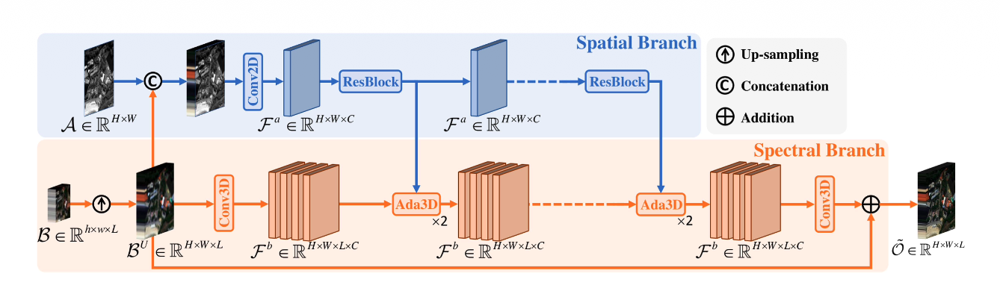
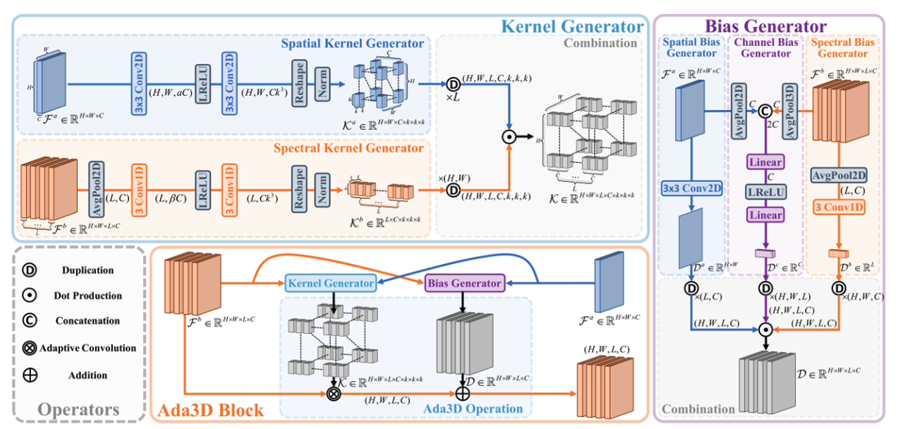

## 研究任务

遥感图像融合需要利用 PAN 图像的空间细节，提高低分辨率多光谱或高光谱图像的空间分辨率，同时保留其光谱信息。现有二维卷积通常将光谱波段作为通道处理，难以充分建模光谱与空间的联合关系；普通三维卷积虽然可以同时处理这两个维度，但卷积核固定，无法灵活适应不同地物的特征，而且计算开销较大。因此，Ada3D 要解决的问题是：如何以较低的计算成本，根据图像不同位置的空间结构和光谱特征，自适应地生成三维卷积核，实现空间细节增强与光谱信息保持？

## 整体架构

首先是空间分支，PAN图像\(\mathcal A\)和上采样的多光谱图像\(\mathcal B^U\)concat，为了在提取特征时也可以参考光谱信息，然后进行二维卷积，得到空间特征图\(\mathcal F^a \in \mathbb{R}^{H \times W \times C}\)然后进入残差模块，不断提取特征；然后就是光谱分支，上采样之后进行三维卷积得到光谱特征图\(\mathcal F^b \in \mathbb{R}^{H \times W \times L \times C}\)然后进入Ada3D模块利用空间特征来优化光谱特征；最后进行一次三维卷积然后核上采样光谱图相加得到最终输出\( \mathcal{\tilde{O} }\in \mathbb{R}^{H \times W \times L}\)

## 核心模块：Ada3D

### 卷积核生成器

空间卷积核生成器就是利用空间特征图，进形两次3x3的二维卷积，卷积会扩展特征通道的维度，然后reshape得到需要的每个体素对应的空间卷积核；光谱卷积核生成器就是利用光谱特征图，首先进行二维全局池化，使其维度变成\(\mathbb{R}^{L \times C}\)，然后进行两次一维卷积，同样，卷积时扩展特征通道的维度，然后reshape得到光谱的卷积核，然后就是两个卷积核的合成，因为维度不一样，在合成前，先进进行一次duplicate，扩展到对应维度。然后进行hadamard积，得到最终的卷积核。

### 偏置生成器

是有三个偏置生成器的hadamard积得到的，分别是空间偏置生成器、光谱偏置生成器和通道偏置生成器，生成器原理如图所示；通道偏置生成器，首先空间特征图进行二维全局池化，得到特征通道，然后就是光谱特征图进行三维全局池化，得到特征通道，然后对这两个特征通道进行concat，然后进行两次线性映射，最后对三个偏置进行duplicate（广播）得到同意维度张量，然后就是进行hadamard积得到最后的偏置。

### Ada3D模块

输入是空间特征图和光谱特征图，然后进入卷积核生成器和偏置生成器，然后利用卷积核在光谱生成图上进行卷积，卷积完成后加上偏置就得到学习后的光谱特征图。
