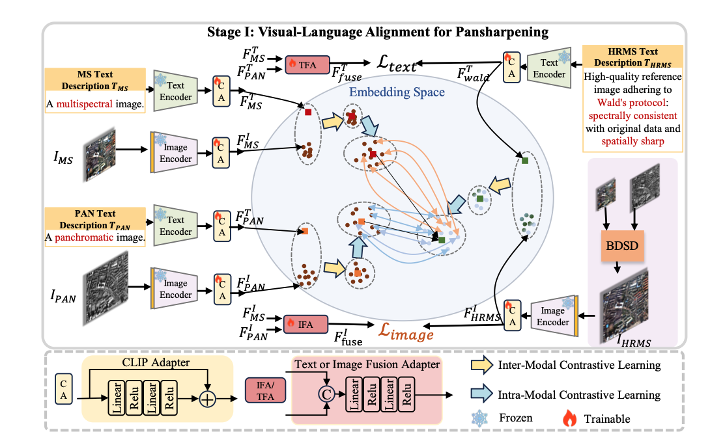
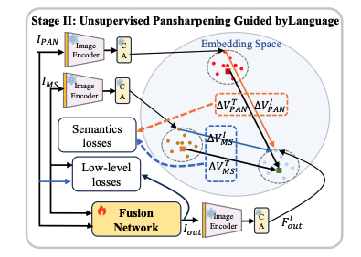

## 整体方法

预训练CLIP使其能够处理MS图像，适配阶段结束后，使CLIP固定成语言监督器，用空间光谱一致性，模态对齐，细节保持，来当作训练目标，采用参数高效微调策略，加入CLIP Adapter （CA），这篇文章的文本是人工固定编写好的文本提示

## CLIP 适配阶段

### 跨模态对比学习 InterMCL

在图像内容和文本间，让匹配的图像与文本的特征相似，不匹配的特征不相似，就是那类图像对应那类文字描述

### 模态内对比学习 IntraMCL

进行图像模态内的学习，让CLIP知道图片的具体内容，生成不同的图像特征。

### 融合感知对齐

加入图像融合适配器IFA和文本适配器TFA，利用ms和pan的图像特征进入IFA生成图像的融合特征，利用ms和pan的文本特征进入TFA生成文本的融合特征

### 适配阶段损失

\(L_{s1}\)=\(L_{inter}\)+\(L_{intra}\)+\(L_{fusion}\)，\(L_{fusion}=|F_{fuse}^T-F_{wald}^T|_1+|F_{fuse}^I-F_{HRMS}^I|_1\)，Wald协议的文本特征是对所有图像都是相同的，无法描述每张图的各自内容

## 语言引导的无监督全色锐化

使用语义监督和底层视觉监督训练融合网络

### 语义监督

不让融合图像简单的像素级接近Wlad协议的文本特征，要变化方向接近最终特征，

\(\begin{aligned} \Delta V^I_{\mathrm{MS}}&=F^I_{\mathrm{out}}-F^I_{\mathrm{MS}}, &\Delta V^T_{\mathrm{MS}}&=F^T_{\mathrm{wald}}-F^T_{\mathrm{MS}},\\ \Delta V^I_{\mathrm{PAN}}&=F^I_{\mathrm{out}}-F^I_{\mathrm{PAN}}, &\Delta V^T_{\mathrm{PAN}}&=F^T_{\mathrm{wald}}-F^T_{\mathrm{PAN}}. \end{aligned} \tag{7–8}\)然后计算方向损失，要计算ms的图片方向和文本方向的角度差异，从而让输出的语义接近HRMS图像

### 底层视觉约束

光谱一致性：融和的图像进行四倍双三次降采样后，与输入的MS图像比较，使用平方误差和机构相似性SSIM约束

空间清晰度：用1x1的卷积将多光谱通道变成单光谱通道，在于pan比较，同样使用平方误差和SSIM

光谱与空间的权衡项：作者还采用基于 QNR 的指标，结合光谱失真与空间失真 

伪监督：使用一个训练好的全色锐化模型，暂时吧它生成的融合图像作为一伪参考图
