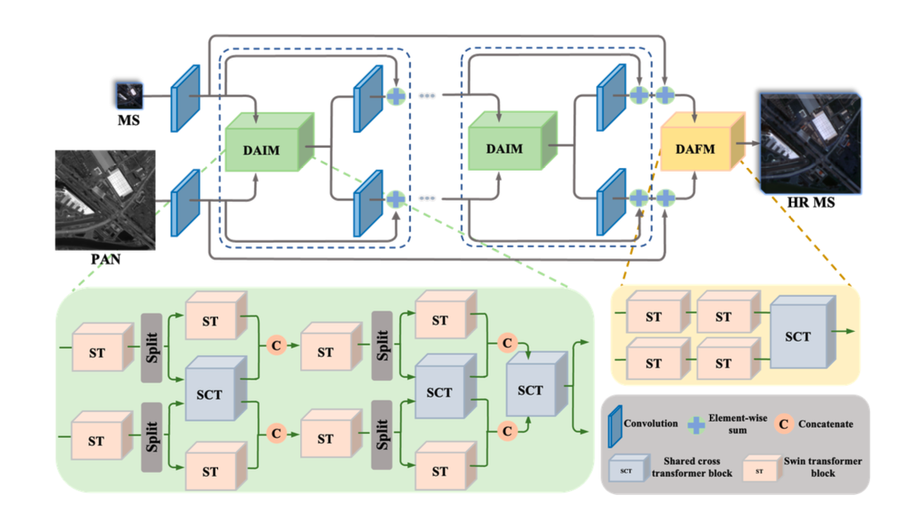

## 整体架构：DANet

采用双尺度注意力交互模块DAIM和双尺度注意力融合模块DAFM，让不同尺度的空间光谱特征直接进行注意力交换，DAIM结合的自注意力的Swin Transformer和交叉注意力的Shared Cross Transfomer。[知识点汇总：Swin Transformer 窗口注意力](../SmallNote/知识点汇总.md#swin-transformer-窗口注意力)。通过共享交叉Transfomer，送入部分尺度的特征来进行跨尺度特征交互。

## 数据增强：MixShuffle

使数据增强。[知识点汇总：高频与低频信息](../SmallNote/知识点汇总.md#高频与低频信息)。对不同训练样本沿空间和光谱通道随机凸组合，制造不常见的混合情况，**感觉可以根据额训练效果，来刻意制造自己训练弱的数据**

## 训练目标：Hierarchical Attention Loss

动态调整梯度，让模型更关注没学好的地方，有像素损失，波段损失和样本损失，误差越大，梯度权值越高
