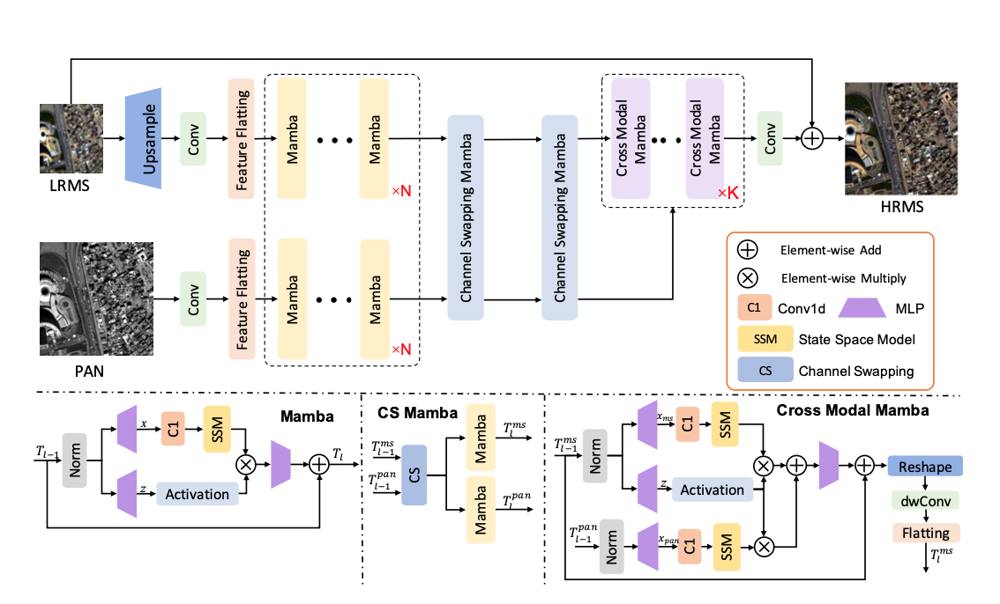

## 研究任务

+ 难以低成本的建模全局信息
+ 两种模态之间融合的还不够充分、高效

## 整体架构

首先两路数据流，第一路是处理LRMS，先上采样，然后卷积，然后展平，第二路是PAN，直接卷积，然后展平，这两路分别进行独立的Mamba，提取各自的长距离信息，然后通过通道交换Mamba进行交互，在通过多个跨模态Mamba块进行深度融合，然后卷积，和上采样LRMS相加得到融合图像。

## 重要模块

### Mamba块

输入序列先进行LayerNorm，然后一路进行内容学习，一路进行门控；内容分支先进行1x1卷积，SiLU激活然后进入SSM(State space Model)学习长距离信息，由MS特征生成的门控分支先进行线性映射，然后SiLU激活，两路结果进行Hadamard积，然后通过线性映射和残差连接。

### 通道交换Mamba块

将多光谱特征和PAN特征，沿通道维度对半分，后半部分交换，然后分别进入Mamba块，进行长距离学习。

### 跨模态Mamba块

类似交叉注意力思想启发，但不是计算注意力，而是通过共享门控实现融合，首先MS和PAN特征分别经过归一化、线性映射、一维卷积，然后进入SSM，学习长距离信息，然后用同一个门控调节输出，然后相加，进行线性映射，然后加上MS特征，也就是残差连接，然后reshape，序列变回二维的，方便进行二维卷积，进行DWConv(Depth- Wise Convolution，也就是逐通道卷积)，再展平，方便进入下一次的多模态Mamba块

## 知识点

### 状态空间模型：

$$
h_t=\hat Ah_{t-1}+\hat Bx_t \\ 
y_t=Ch_t
$$

h理解为内部记忆，x时输入，y是输出；旧记忆结合当前输入，更新生成新记忆，从新记忆中读取信息得到输出

### 普通卷积

每个输出通道汇总所有输入通道的卷积结果

### 逐通道卷积

每个通道使用自己的核，独立处理，不回混合通道
