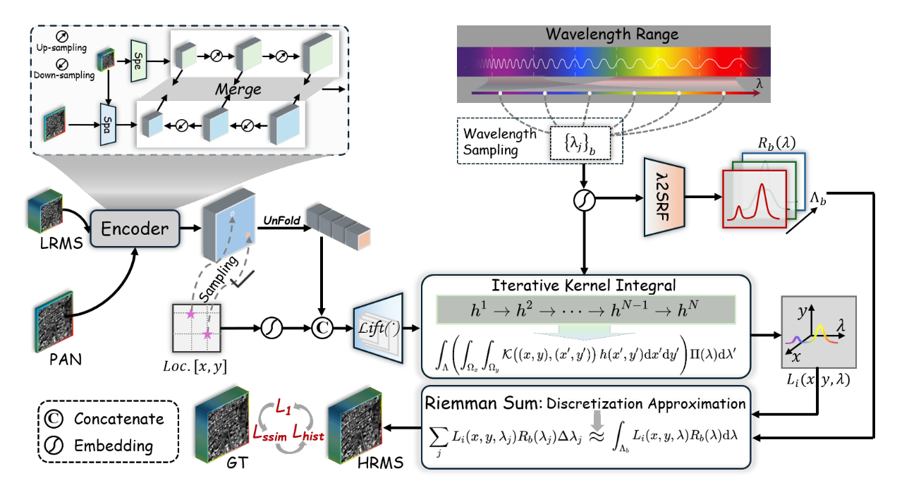

## 研究任务

+ 从物理成像的过程考虑，把光学传感器的成像规律融入全色锐化。
+ 传统方法通常基于简化的成像假设来注入空间细节，难以满足特定传感器的辐射测量特性。基于深度学习的方法从训练数据集中**隐式**学习传感器特征。

## 整体架构

PAN和上采样LRMS进入**BDT**（双向膨胀Transfomer）提取融合特征\(\hat F\)，然后**神经算子**利用空间坐标（周期性傅立叶编码）、波长和融合特征构建**连续光谱场**，按照波段相应加权，得到修正量，最后把修正量加回上采样的MS，最终得到HRMS。

## 核心模块

### 双向膨胀Transfomer（Bidirectional Dilation Transfomer）

结合两种注意力 **膨胀空间自注意力** 和 **分组光谱自注意力** ，有两个分支：空间分支使用膨胀空间自注意力块，从高分辨率输入提取空间特征；光谱分支使用分组光谱自注意力块，从低分辨率MS提取光谱特征。

+ 膨胀空间自注意力：对局部窗口注意力做了改进，使用膨胀率定义“空洞窗口”，扩大覆盖范围。
+ 分组光谱自注意力：先划分8x8的窗口，进行分组，然后每个组内进行通道自注意力。分组的目的主要是让通道关系具有局部自适应性。
+ Merge阶段就是从低分辨率到高分辨率的顺序进行，低分辨率的融合特征上采样进入上一级（也就是更高分辨率）的融合，逐级提升融合分辨率，最终输出融合特征。

### 光谱场的构建

通过对空间坐标进行傅立叶编码后与查询到的位置特征进行concate进入，然后通过核积分算子聚合空间信息，结合波长\(\lambda\)生成光谱表示。其中波长也进行了傅立叶编码。

### 波段响应函数的构建

对编码后的波长映射为响应权重。

## 知识点

### 模型驱动方法

先根据成像规律和人为假设写出来的数学模型，再求解图像。

### 数据驱动方法

准备大量输入和参考答案，让模型学习融合规律。

### 波段观测值

多光谱图像每个光谱通道存储的就是一个波段的光谱观测值，一个波段通常覆盖一段波长范围，例如，某个红波段可能覆盖约630-690nm。传感器对这个范围内不同波长的光信号，按**传感器敏感程度**加权汇总，在转换成**波段观测值**。根据数据的不同处理阶段分为数字量化值、光谱辐亮度和反射率。

### 隐式神经表示（Implicit Neural Represantation）

能够以参数化形式高保真地编码**连续**信号。比如一张64x64的图像，隐式神经表示是使用一个函数表示，可以查询像素和像素之间（亚像素）的数据。

### 神经算子（Neural Operator）

神经算子就是神经网络学习函数与函数之间的映射（学习无限维函数空间之间的映射）。

### 无限维函数空间

因为连续函数在整个定义域上都有值，要完整描述任意一个函数，需要无限多个独立的数值，把所有这类函数组成的集合称为**无限函数空间**

### Unfold

用滑动窗口提取相邻区域，再把窗口内的数值转开成向量。对于nn.Unfold或F.unfold，输入按照下面组织[B,C,H,W]，然后unfold完之后变成[B , kernel_size * kernel_size * C , H * W]，然后在reshape把变化成[B , kernel_size * kernel_size * C , H , W]。
