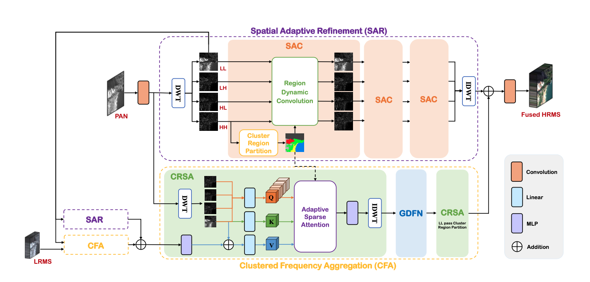
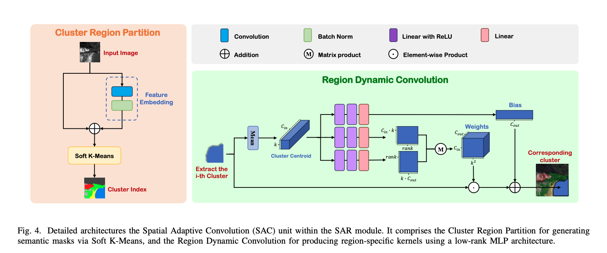
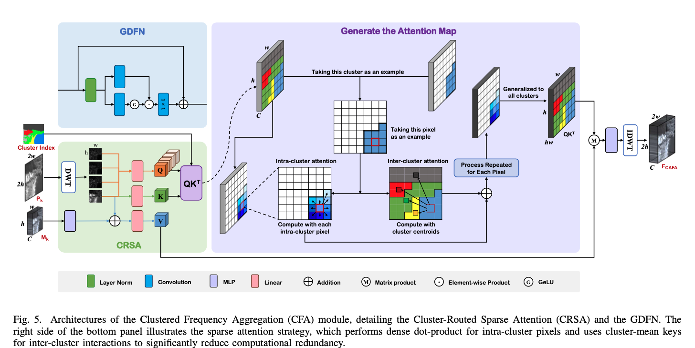

## 研究任务

现有全色锐化方法通常使用静态卷积提取空间细节，难以适应遥感影像中不同地物区域和不同频率分量的差异，容易削弱高频细节；而基于 Transformer 的融合方法需要计算大量贡献很小的全局注意力交互，计算量和内存开销较大。如何利用遥感影像的区域相似性，为不同区域和频率分量自适应地提取空间细节，同时减少冗余的注意力计算，在保留光谱信息的基础上，兼顾融合质量与计算效率。

## 整体架构

网络主要由两个模块组成，分别是SAR（空间自适应细化）和CFA（聚类频率聚合）这两个模块是相互耦合的

首先PAN先通过输入卷积提取特征后进入的是高尺度分支，LRMS进入的是低尺度分支；首先是高尺度分支，PAN特征图通过**小波变换**后的到四个分量子带，然后多次进入**空间自适应卷积模块**，来增强四个子带到空间特征，最后通过**逆小波变换**得到空间增强特征图；高尺度的LL分量进入低尺度的分支，CFA模块就是通过**簇路由离散注意力模块**，对同一尺度分支的的空间特征图和低尺度的中间融合特征进行**自适应离散注意力**，随后进入MLP和逆小波变换得到融合特征，然后通过**门控深度前馈网**来过滤冗余信息，然后在进行一次簇路由离散注意力得到的融合特征图，与该尺度的空间增强特征图进行融合得到中间融合特征，然后进入高尺度分支进行融合，最终得到最终尺度的融合图像。

## 核心模块

SAC的结构

+ Cluster Region Partition（聚类区域划分）：通过特征提取和残差连接得到新的特征表示，然后进入soft K-means聚类得到簇类索引。
+ Region Dynamic Convolution（区域动态卷积）：对四个子带分别处理，每个子带都按照簇类进行处理，首先把簇内所有像素的相邻区域特征展平，所有相邻区域特征求和在除簇内元素个数，形状是\(\mathbb{R}^{k^2 \times C_{in}}\)，然后展平进入三个并行的MLP分支分别产生两个低秩矩阵和偏置向量，两个低秩矩阵点乘得到该簇类的卷积权重W，簇内元素共享这个卷积权重，然后与簇内的像素进行hadamard积，加上偏置就得到了更新后的特征。

CFA的结构

+ Cluster-Routed Sparse Attention（簇路由稀疏注意力）：首先是同一尺度的空间增强特征图进入小波变换生成四个子带分量，然后这四个子带分量进行线性映射得到四个Q矩阵，但是用同一组K、V，但查询内容不同，注意力权重也不同，因为低频具有整体空间结构，用该子带作为空间键，然后中间融合特征图与低频子带进行融合后进行线性映射后作为V，利用同一尺度的空间自适应细化模块的簇类区域划分图，进行稀疏注意力，同一簇内各个token都算注意力，不同簇内的只与该簇的平均键来算注意力，最后得到特征图，然后进入MLP进行特征重建，最后对四个子带进行逆小波变换得到融合特征图。
+ Gated Depthwise Forward Network（门控深度前馈网络）：为了抑制稀疏注意力机制传递冗余信息，对稀疏注意力得到的结果进行细化，调节哪些特征应该被增强，哪些特征应该被削弱。首先归一化后分为两路都进行3x3卷积，其中一路进行GELU，然后两分支计算hadamard积，然后进行1x1卷积融合不同通道信息，然后进行残差连接。

