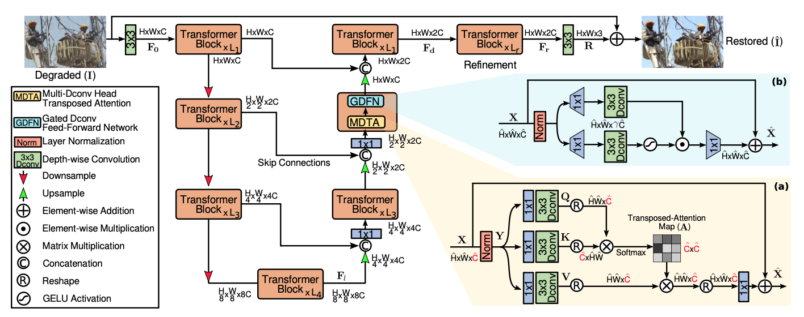

## 研究任务

+ 传统的Transformer虽然可以联系远距离的位置，但计算复杂度随空间分辨率呈二次增长。
+ 传统的CNN虽然高效，感受野有限，难以根据输入内容自适应调整。
+ 验证了渐进式学习策略对Restormer的有效性，即训练初期使用较小的图像块和较大的批次，随着训练的推荐，逐渐增大图像块尺寸，同时减小批次大小。

## 整体架构

输入的图像\(I\)先通过3x3卷积提取低层特征得到\(F_0\)，其中C表示特征通道数，随后浅层特征经过一个四层对称编码器-解码器，转换为深层特征，逐层减少空间尺寸同时增加通道数量。编码器特征通过跳跃连接与解码器特征进行拼接，除最顶层外，每一层拼接后使用1x1卷积，将通道数减半。顶层则是直接聚合，没有降低通道数，这一步有助于恢复图像的精细结构和纹理细节。随后通过一个Transfomer模块进行微调，最后使用卷积层生成残差图像，将残差图像与退化图像相加得到恢复结果。

## 核心模块

### 多深度卷积头转置注意力

Multi-Dconv head Transposed Attation，MDTA，将注意力从空间位置上，转移到特征通道之间，并利用卷积引入局部空间信息。先采用1x1卷积，在每个像素位置上融合跨通道信息，再使用3x3深度卷积，在每个通道内部编码空间上下文。
$$
Q=W_d^QW_p^QY,\qquad
K=W_d^KW_p^KY,\qquad
V=W_d^VW_p^VY
$$
其中\(W_p\)表示1下逐点卷积，\(W_d\)表示3x3深度卷积，网络使用不带偏置的卷积层。接着对Q和K进行Reshape，注意是QK相乘而不是KQ，但是不重要，重要的是得到CxC的通道注意力，使其生成CxC的转置注意力图，随后进行Softmax，然后对转置注意力和V进行点乘，然后Reshape得到残差，然后进行1x1卷积细化一下，和输入进行残差相加。

### 门控深度卷积前馈网络

Gated-Dconv Feed-forward Network，GDFN，结合局部空间处理和门控机制，控制哪些特征向后传递。该模块改善了门控机制和深度卷积。引入深度卷积，融合空间邻近像素的信息，有助于学习局部图像结构。
$$
\hat X=W_p^0\,\operatorname{Gating}(X)+X \\
\operatorname{Gating}(X) = \phi\!\left(W_d^1W_p^1(\operatorname{LN}(X))\right) \odot W_d^2W_p^2(\operatorname{LN}(X))
$$
其中\(W_p\)表示1下逐点卷积，\(W_d\)表示3x3深度卷积。门控机制通过两条并行变换分支的Hadamard积来实现，，其中一条分支经过GeLU非线性激活。

