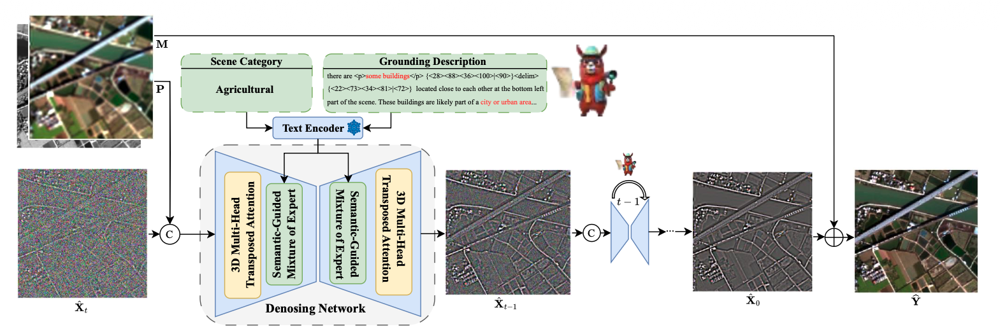
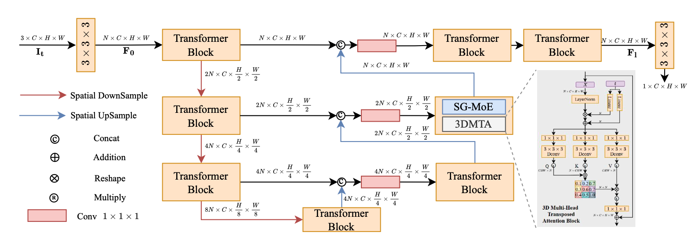

## 研究任务

+ 提升模型的泛化能力，同一个模型适应不同的卫星，不同的传感器波段，光谱响应和成像特点。
+ 利用双粒度语义信息（场景级和区域级）引导扩散模型。

## 整体架构

模型学习残差，最后加在LRMS上就好，然后使用预训练的GeoChat获取文本语义，MS图像用于获得场景语义的分类，是粗粒度语义，PAN图像用于获得区域级语义信息，是细粒度语义，随后分别经过预训练的CLIP文本编码器，转化为网络可用的语义特征。场景级语义和区域级语义分别选择合适的通道来处理输入特征。去噪网络采用编码器解码器结构，其中的Transfomer模块包含3D注意力和SG-MoE，双粒度语义通过SG-MoE影响去噪过程。下图是去噪网络就是包含多个tranfomer块的U-net网络，类似于编码器-解码器结构。

## 核心模块

### 语义引导的混合专家模块

MS图像进入GeoChat生成场景分类，例如河流、农业、建筑等，PAN图像进入GeoChat生成区域描述，这两组语义信息分别进入预训练好的文本编码器CLIP，然后分别进入各自的MLP以及Softmax函数生成一组潜在的专家混合权重\(e_s 和 e_g\)，然后混合权重进入带有ReLU激活函数的Linear，为各个通道生成门控分数。输入特征\(x\)先进入场景门控得到\(F_s\)，然后再进入区域门控得到\(F_g\)，但门控权重是独立生成的。损失函数设计了一个对门控输出施加一个稀疏正则，增强混合权重的多样性，促进专家选择的稀疏性。

