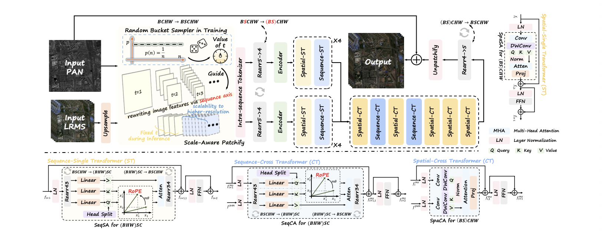

## 整体方法

<!-- 暂未核验到正式出版 DOI，保留 CVF 正式论文页面。 -->

让PAN来引导MS进行融合图像

## 核心模块

### Scale Aware Patchify

SAP把图像序列化，训练时裁剪块固定，但随机选择不同大小的切块窗口，使序列长度大小不一，

### Spatial Transformer

学习每个patch的纹理边缘

### Sequence Transformer

学习patch之间的关系，利用RoPE进行位置编码
