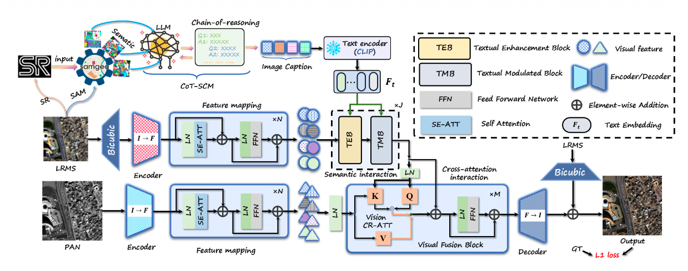
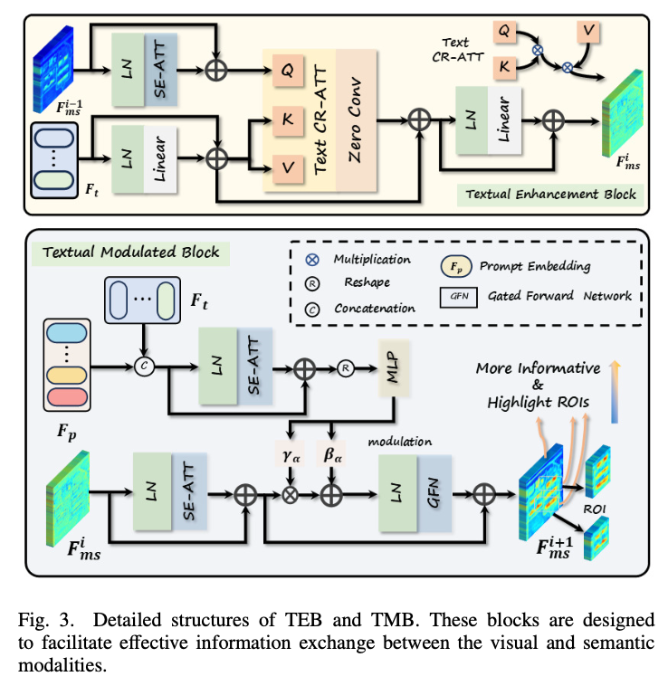

## 整体框架

## 核心模块

### 基于 CoT 的语义描述生成

LRMS 图像进入Real-ESRGAN 超分辨率增强得到SAMGeo 生成分割图，将超分辨率图\(I_{sr}\)、分割图\(I_{seg}\)、卫星特定信息\(P_s\)和链式引导方式\(P_{chain}\)一起输入MLLM(Multimodal Large Language Model)如GPT-4o生成**遥感影像描述**\(T_{lms}\)，随后利用**CLIP文本编码器**（已经训练好）将其编码成**文本特征**\(F_t\)。

### 视觉编码器

LRMS上采样然后进入**视觉编码器**，PAN图像直接进入**视觉编码器**，进行特征提取。
$$
f_{ms}=SE \circ LN(Conv(I_{lms}))+Conv(I_{lms})
$$

$$
F_{ms}=FFN \circ LN(f_{ms})+f_{ms}
$$

SE代表自注意力操作，这是一个典型的Pre-LN Transfomer块。

### 文本增强与调制：TEB / TMB

#### TEB（Textual Enhancement Block）

第i-1轮TMB生成的融合多光谱特征\(F_{ms}\)和CLIP生成文本特征\(F_{t}\)一起进入TEB，先分别进行预处理，然后进行交叉注意力，多光谱特征做Query，文本特征做Key、Value，生成第i轮的多光谱融特征
#### TMB（Textual Modulated Block）

TEB的输出即融合的光谱特征，CLIP生成的文本特征\(F_t\)、可学习提示prompt特征\(F_p\)进入TMB。首先\(F_t和F_p\)拼接然后执行注意力和残差连接，reshape后进入多层感知机MLP，输出两个细粒度语义参数，促进模态间的交互。视觉特征\(F_{ms}\)进行自注意力处理和残差连接，然后用生成的两个参数进行缩放和平移，最后通过门控前向网络和残差连接生成MS图像融合特征。

### 视觉融合模块

多光谱的特征和PAN的特征进行融合，使用交叉注意力，Query取自LRMS的图像特征，Key和Value取自PAN的图像特征，融合后经过解码和双三次插值后的LRMS图像进行残差连接，最后得到HRMS图像。

## 损失函数

采用L1损失，就是输出和真实的差距
