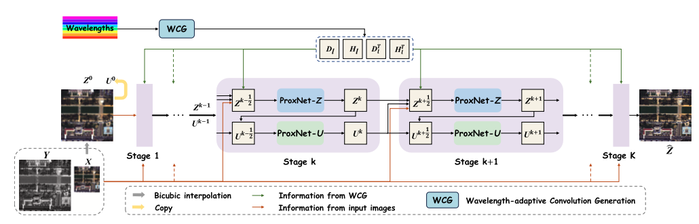
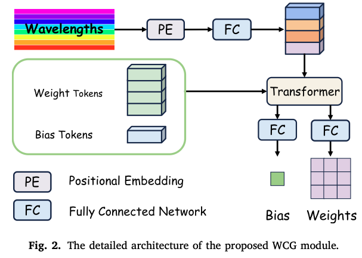
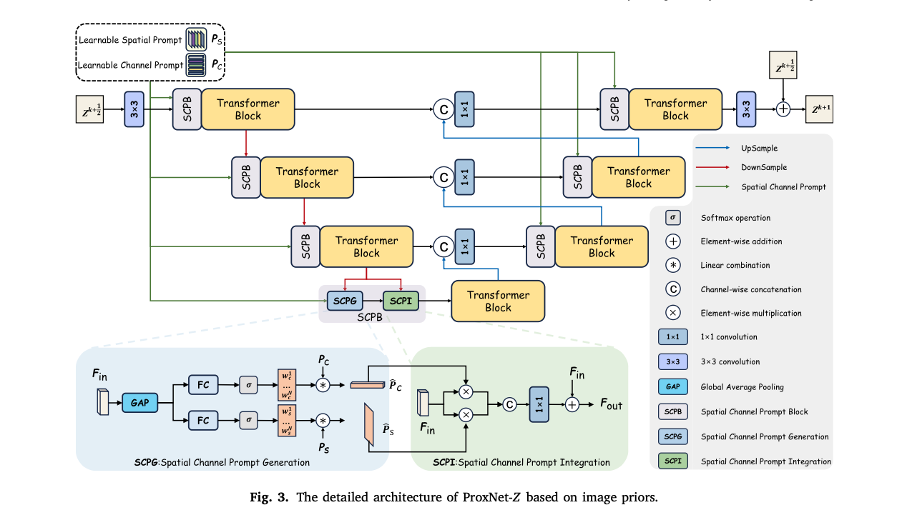
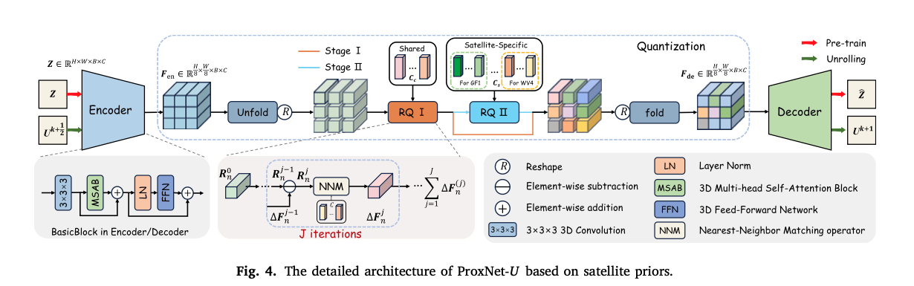

## 研究任务

现有全色锐化模型通常针对单颗卫星单独训练，不同卫星在空间分辨率、光谱波段配置和噪声特性上的差异，使模型难以直接迁移到其他卫星。若将多卫星数据混合训练，模型又容易把**通用空间规律**与**卫星特有的光谱特征**混在一起；而普通深度学习模型还缺少明确的物理约束。如何在一个模型中处理多颗卫星的数据，同时区分卫星特有信息与当前图像自身的特征，并兼顾物理可解释性和融合效果。

## 整体架构

**论文先把 LRMS 上采样得到初始 Z，再复制一份作为初始 U。之后交替更新两者：Z 结合 LRMS、PAN 的观测约束，通过 ProxNet-Z 改善当前图像的**空间和光谱特征**；U 根据更新后的 Z，通过 ProxNet-U 加入对应**卫星的先验知识**，再帮助下一轮 Z 的重建。WCG 根据卫星的波段信息生成相应的退化算子。整个过程重复 3 轮，最终输出 Z，作为融合后的 HRMS 图像。

## 核心模块

### WCG：退化算子生成

输入各波段的中心波长，将波长转换成特征向量，Transformer 分析波段之间的关系，生成卷积核，用于模拟该卫星的**空间和光谱退化算子**。

### ProxNet-Z：图像先验

采用四层 U-Net，在编码器和解码器的每个 Transformer 前加入**空间—通道提示模块**：输入特征经 GAP、全连接层和 Softmax 计算组合权重，对 5 组可学习基础模板加权，生成当前图像的空间提示和通道提示；两种提示分别与特征逐元素相乘，再经通道拼接、1×1 卷积和残差连接融合，随后交给 Transformer 处理，最终重建修正后的 HRMS。

### ProxNet-U：卫星先验

ProxNet-U 的流程分为“**预训练高质量先验**”和“**在全色锐化中使用先验**”两部分。通过三级编码器中的 3D 卷积、光谱注意力和 FFN 提取特征，空间尺寸从 `H×W` 下采样到 `h×w`。每个空间位置的 `B×C` 个特征被整理成一个向量，准备进行码本匹配。

#### 学习共享码本

，所有卫星的 HRMS 图像使用同一个共享码本。每个特征向量进行多轮（J1）残差量化：选取最近的码向量、减去它、继续匹配剩余误差。累加选中的码向量，再通过解码器重建原图，利用重建损失和量化损失联合训练编码器、码本与解码器。

#### 学习卫星特定码本

，在共享码本的基础上，为各卫星加入专用码本。前 3 轮量化使用共享码本，后 3 轮根据卫星来源选择专用码本，表示剩余特征。继续通过自重建训练，让两类码本分别表示共有规律和卫星特有变化。

#### 接入全色锐化网络

，输入当前迭代的中间结果，执行同样的“编码 → 共享与专用码本残差量化 → 累加码向量 → 解码”过程，输出修正结果。此时**冻结码本和解码器，只训练编码器**，让输入特征适配已经学好的高质量先验。
