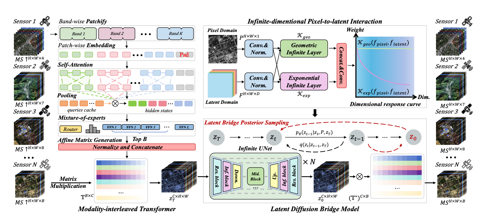

## 整体框架

## 核心模块

### Modality-interleaved Transformer MiT

将LRMS逐波段映射到潜在空间映射空间，用到了Cayley formulation，是让矩阵更佳

### Latent Diffusion Bridge Model 潜在扩散桥接模型

#### 训练过程

学习从低质量分布\(（低质量潜在表示）z_T\)推导到高质量分布\(（高质量潜在表示）z_0\)，随机状态 \(z_t\)表示t时刻到潜在特征图，随机规律变化由随机微分方程表示。

#### 推理过程

与普通扩散模型不同（从纯噪声开始）而是在低质量潜在图像开始，知道了\(z_t\)中间状态的转移概率分布，然后的得到\(z_t到z_{t-1}\)的推导公式，因此就可以预测出下一状态的高质量表示和噪声，网络学习其反向过程，推理时预测噪声\(\epsilon_t\)和中间状态的高质量表示，计算出\(z_{t-1}\)

### 桥接后验采样

推理时进行，利用噪声\(\epsilon_t\)等价于估计数据分布的得分函数，也就是概率密度对数关于当前形态的梯度，通过贝叶斯公式对概率密度对数梯度得到  \(\text{恢复方向} = \text{高质量图像先验} + \text{输入观测约束}.\)     先验项+似然项，也就是用似然项来预测和输入的ms一致性

### Infinite-dimentional Pixel-to-latent Interaction 无限维像素到潜在空间交互

设计了几何核和指数核，用来融合特征的非线性函数，几何核重视高阶复杂交互，指数核偏向于低阶，让PAN图像的空间细节，持续参与MS潜在特征的修复

## 损失函数

同时约束潜在空间和像素空间，潜在空间的约束是，预测的潜在特征\(z_0^t\)与真实图像的潜在特征\(y \mathcal T\)像不像，像素空间的约束是预测的潜在特征还原到原始波段空间\(z_0^t \mathcal T^*\)和真实图像y像不像
